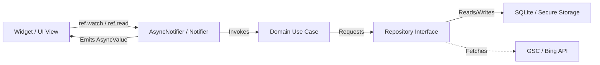
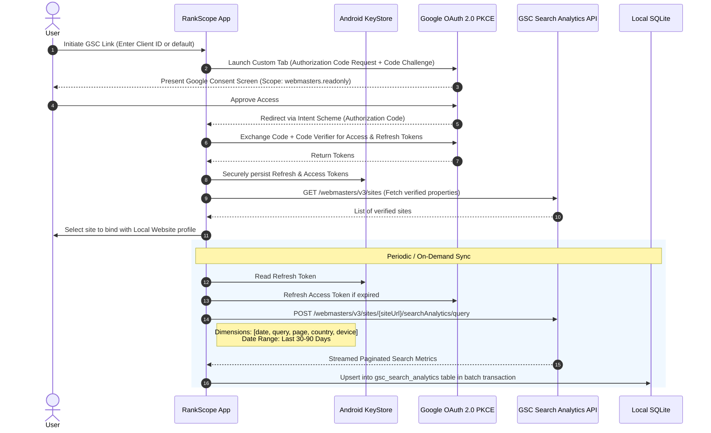
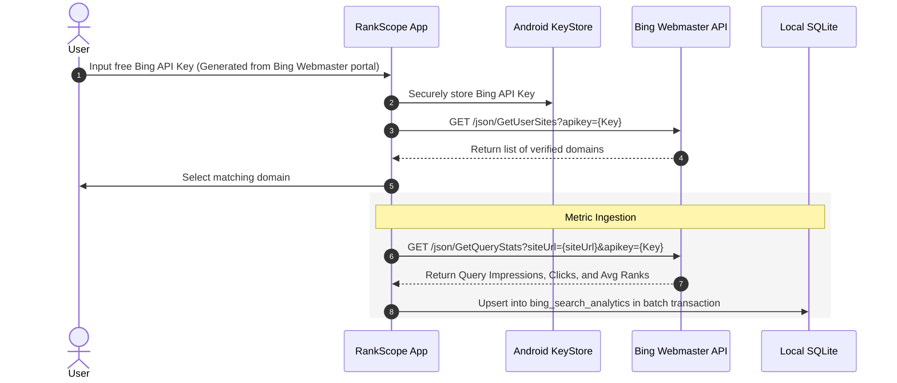
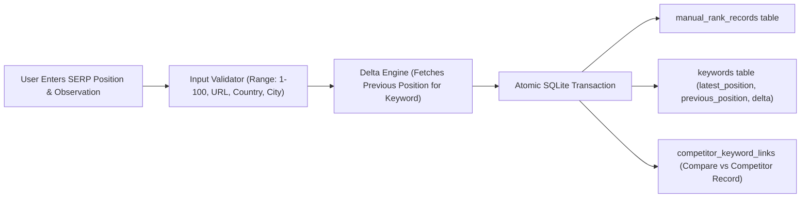
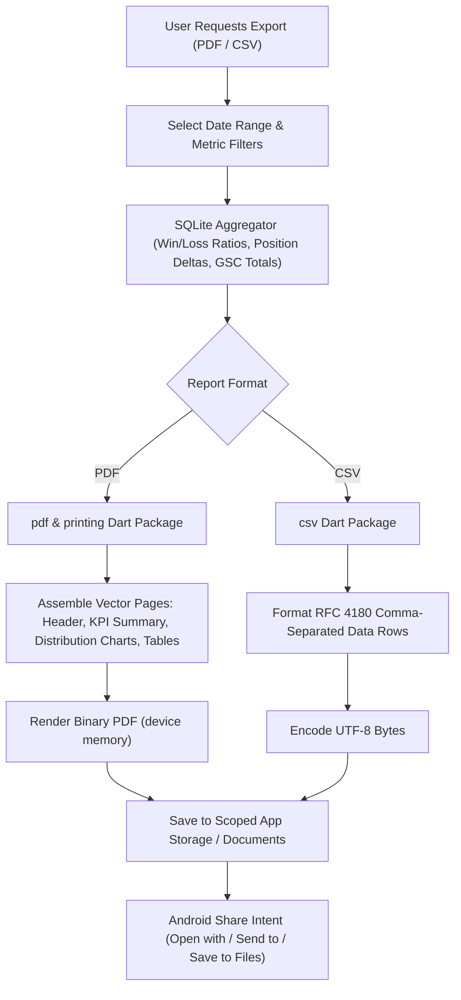
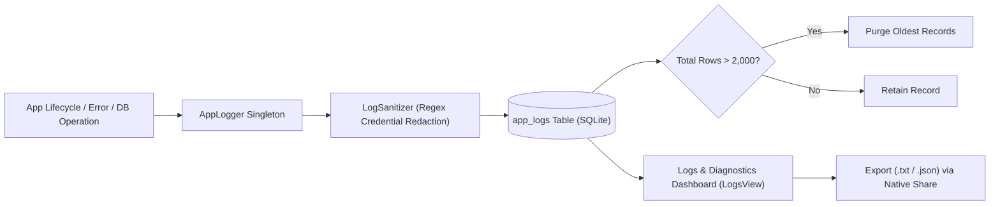

# RankScope Architecture Specification 🏗️

This document details the architectural blueprint, structural design patterns, data flow mechanisms, and hardware-level constraints for **RankScope**.

---

## 1. System Philosophy & Constraints

```mermaid
flowchart TD
    subgraph DeviceBoundary ["Android Device Boundary (100% Local & Zero Backend)"]
        UI["Flutter Presentation Layer (Light Mode UI)"]
        State["Riverpod State Management Layer"]
        Domain["Domain Entities & Use Cases"]
        DataRepo["Data Repositories"]
        SQLite[("Embedded SQLite DB (sqflite)")]
        SecureStore[("Android KeyStore (flutter_secure_storage)")]
        ReportEngine["Local Document Engine (PDF & CSV)"]
        FS["Android Scoped App Storage / Documents"]
    end

    subgraph FreeExternalGateways ["Direct HTTPS Gateways (Free, Official, Optional)"]
        GSC["Google Search Console API (OAuth 2.0 PKCE)"]
        Bing["Bing Webmaster Tools API (Free API Key)"]
    end

    UI --> State
    State --> Domain
    Domain --> DataRepo
    DataRepo --> SQLite
    DataRepo --> SecureStore
    DataRepo -.->|Direct HTTPS (No Proxy)| GSC
    DataRepo -.->|Direct HTTPS (No Proxy)| Bing
    DataRepo --> ReportEngine
    ReportEngine --> FS
```

### Core Architectural Axioms
1. **Zero-Backend / Offline-First**: No centralized server, cloud worker, or intermediate proxy exists. The app operates completely without an internet connection, functioning normally in offline mode for manual tracking and reporting.
2. **Deterministic Data Integrity**: Google Search Console "average position" (a statistical aggregated metric) is strictly isolated from "manual SERP rank" (a discrete point-in-time snapshot).
3. **Hardware-Backed Security**: Third-party OAuth tokens and API access keys are never written to plain-text SQLite databases or shared preferences. They are committed directly to the Android KeyStore.
4. **$0 Capital Expenditure**: All integrations use public REST interfaces provided free of charge by search platforms for verified webmasters.

---

## 2. Recommended Flutter Project Structure (Feature-First Clean Architecture)

RankScope adopts a **Feature-First Clean Architecture** with strict layer separation to guarantee testability, maintainability, and clean dependency boundaries.

```text
lib/
├── app.dart                                # Root MaterialApp configuration & theme bindings
├── main.dart                               # App entry point, dependency overrides, initialization
│
├── core/                                   # Application-wide singletons, primitives, utilities
│   ├── constants/                          # System constants, API endpoints, limits
│   │   ├── api_endpoints.dart
│   │   ├── app_constants.dart
│   │   └── database_constants.dart
│   ├── database/                           # SQLite engine, migrations, connection pool
│   │   ├── app_database.dart
│   │   ├── database_migrations.dart
│   │   └── migrations/
│   │       ├── m001_initial_schema.dart
│   │       └── m002_add_serp_features.dart
│   ├── errors/                             # Failure types, exceptions, error mapper
│   │   ├── exceptions.dart
│   │   └── failures.dart
│   ├── network/                            # Network client wrapper, SSL pinning, connectivity
│   │   ├── api_client.dart
│   │   └── network_info.dart
│   ├── security/                           # Encrypted token storage & key management
│   │   └── secure_storage_service.dart
│   ├── theme/                              # Light Mode design tokens, typography, colors
│   │   ├── app_colors.dart
│   │   ├── app_text_styles.dart
│   │   ├── app_theme.dart
│   │   └── spacing.dart
│   └── utils/                              # Formatters, date math, validators, hash utils
│       ├── checksum_util.dart
│       ├── date_formatter.dart
│       └── url_validator.dart
│
├── features/                               # Self-contained business modules
│   ├── websites/                           # Property management (Own + Competitor)
│   │   ├── data/
│   │   │   ├── datasources/local_websites_datasource.dart
│   │   │   ├── models/website_model.dart
│   │   │   └── repositories/websites_repository_impl.dart
│   │   ├── domain/
│   │   │   ├── entities/website.dart
│   │   │   ├── repositories/websites_repository.dart
│   │   │   └── usecases/add_website.dart, get_websites.dart, delete_website.dart
│   │   └── presentation/
│   │       ├── controllers/websites_controller.dart
│   │       ├── states/websites_state.dart
│   │       └── views/websites_overview_view.dart, website_detail_view.dart, add_website_dialog.dart
│   │
│   ├── keywords/                           # Keyword catalog & tagging
│   │   ├── data/
│   │   ├── domain/
│   │   └── presentation/
│   │
│   ├── manual_tracking/                    # Manual SERP rank logging, deltas, city/country
│   │   ├── data/
│   │   ├── domain/
│   │   └── presentation/
│   │
│   ├── search_console/                     # Google Search Console OAuth & Sync
│   │   ├── data/
│   │   │   ├── datasources/gsc_remote_datasource.dart
│   │   │   ├── datasources/gsc_local_datasource.dart
│   │   │   ├── models/gsc_metric_model.dart
│   │   │   └── repositories/gsc_repository_impl.dart
│   │   ├── domain/
│   │   │   ├── entities/gsc_query_metric.dart
│   │   │   ├── repositories/gsc_repository.dart
│   │   │   └── usecases/sync_gsc_metrics.dart, authenticate_gsc.dart
│   │   └── presentation/
│   │       ├── controllers/gsc_sync_controller.dart
│   │       └── views/gsc_analytics_view.dart, gsc_auth_settings_view.dart
│   │
│   ├── bing_webmaster/                     # Bing Webmaster Tools API Sync
│   │   ├── data/
│   │   ├── domain/
│   │   └── presentation/
│   │
│   ├── analytics/                          # Unified charts, SERP shift comparisons, trends
│   │   ├── data/
│   │   ├── domain/
│   │   └── presentation/
│   │
│   ├── reporting/                          # Local PDF & CSV generation engine
│   │   ├── data/
│   │   │   ├── generators/pdf_report_generator.dart
│   │   │   └── generators/csv_report_generator.dart
│   │   ├── domain/
│   │   └── presentation/
│   │
│   └── backup_restore/                     # Database export, import, checksum integrity
│       ├── data/
│       ├── domain/
│       └── presentation/
│
├── routing/                                # GoRouter declarative configuration
│   ├── app_router.dart
│   └── route_names.dart
│
└── shared/                                 # Reusable UI widgets, badges, empty states
    ├── widgets/
    │   ├── buttons/app_primary_button.dart, app_secondary_button.dart
    │   ├── cards/rank_metric_card.dart, ranking_badge.dart
    │   ├── dialogs/confirmation_dialog.dart
    │   ├── feedback/empty_state_view.dart, error_banner.dart
    │   ├── inputs/app_text_field.dart, country_picker_dropdown.dart
    │   └── tables/rank_comparison_table.dart
```

---

## 3. State Management Architecture

RankScope standardizes on **Flutter Riverpod 2.x** with code generation (`riverpod_annotation`).



### Why Riverpod?
1. **No Flutter Context Requirement for Logic**: Pure Dart business logic and repositories can be tested without mocking `BuildContext`.
2. **Fine-Grained Rebuilding**: Only widgets watching changed properties re-render, preserving battery and 60/120 FPS scrolling on mobile devices.
3. **Compile-Time Safety**: Providers cannot fail with runtime lookup errors (unlike inherited widgets or traditional Provider).
4. **Built-in Async Lifecycle Handling**: `AsyncValue<T>` seamlessly handles `loading`, `error`, and `data` states with built-in pull-to-refresh ergonomics.

---

## 4. Navigation Architecture

RankScope uses **GoRouter** for strict declarative routing, back-stack handling, and deep link readiness.

```text
/                                           (Redirects to /dashboard)
└── /shell                                  (StatefulShellRoute with Persistent Bottom Navigation)
    ├── /dashboard                          (Tab 0: Executive Overview & High-Level KPIs)
    │   └── /website/:id                    (Website Deep Dive: Keywords, Parity Matrix)
    │       └── /keyword/:keywordId         (Keyword Historical Trajectory & SERP Audit)
    │
    ├── /rank-tracker                       (Tab 1: Manual SERP Position Logger & Auditing)
    │   ├── /log-entry                      (Add Manual Rank Check)
    │   └── /bulk-audit                     (Rapid Multi-Keyword Position Verification)
    │
    ├── /search-console                     (Tab 2: Google Search Console Performance Hub)
    │   ├── /queries                        (Query Performance Breakdown)
    │   ├── /pages                          (Top Landing Pages by Clicks & Impressions)
    │   └── /countries                      (Geographic Performance Distribution)
    │
    ├── /bing-webmaster                     (Tab 3: Bing Webmaster Performance Hub)
    │   └── /queries                        (Bing Query Statistics)
    │
    └── /settings                           (Tab 4: Integrations, Backup/Restore, Preferences)
        ├── /auth/google                    (Google OAuth Client ID & Scope Management)
        ├── /auth/bing                      (Bing API Key Setup)
        ├── /backup-restore                 (Database Snapshot Export & Import)
        └── /about-privacy                  (Privacy Policy & Data Sovereignty Details)
```

---

## 5. UI Design System (Premium Minimalist Light Mode Only)

RankScope is purposefully designed with an **uncompromising, distraction-free Light Theme**. SEO analysis requires reading dense tables, percentages, and position numbers; low-contrast or over-stylized dark surfaces increase visual fatigue during long analytical sessions.

### Design Tokens

| Token Group | Token Name | Hex Value | Purpose / Application |
|---|---|---|---|
| **Backgrounds** | `surfacePrimary` | `#FFFFFF` | Page canvas, modals, bottom sheets |
| | `surfaceSecondary` | `#F8F9FA` | Card backgrounds, table header bars, chip fills |
| | `surfaceTertiary` | `#F1F3F5` | Input field backgrounds, disabled state containers |
| **Borders & Dividers**| `borderSubtle` | `#E9ECEF` | Card outlines, table grid lines, subtle dividers |
| | `borderMedium` | `#CED4DA` | Text field outlines, active border states |
| | `borderFocus` | `#212529` | Focused input border, selection indicators |
| **Typography** | `textPrimary` | `#1A1D20` | Headings, primary metrics, active labels |
| | `textSecondary` | `#495057` | Body text, table data cells, subtitles |
| | `textTertiary` | `#868E96` | Timestamps, metadata, placeholder hints |
| **Rank Status Tokens** | `rankGain` | `#2B8A3E` | Position increase (+2, +5), positive CTR shifts |
| | `rankDrop` | `#C92A2A` | Position decline (-3, -10), negative CTR shifts |
| | `rankStable` | `#868E96` | Position unchanged (0 / neutral dash) |
| | `rankTop3` | `#D97706` | Position 1-3 highlight badge (Gold accent) |
| | `rankTop10` | `#2563EB` | Position 4-10 highlight badge (Indigo accent) |

### Visual Styling Rules
- **Elevation**: Elevation shadow `0dp` across the entire app. Containers use crisp 1dp outlines (`#E9ECEF`) and distinct background fills (`#FFFFFF` on `#F8F9FA`) instead of fuzzy drop-shadows.
- **Corner Radius**: Standardized 8dp on cards and buttons; 6dp on badges and data chips.
- **Grid System**: Strict 8dp grid (8, 16, 24, 32, 48dp paddings).
- **Typography Scale**: High-legibility geometric sans-serif (Inter or system Roboto) with clear weight distinction:
  - Display KPI: 32sp, Bold (W700)
  - Section Header: 20sp, SemiBold (W600)
  - Table Cell Metric: 14sp, Medium (W500)
  - Caption / Metadata: 12sp, Regular (W400)

---

## 6. Free Google Search Console Integration Design



### Critical Implementation Specifications
1. **OAuth 2.0 PKCE Flow**: No backend server is required to hold client secrets. The authorization code flow with PKCE (`code_challenge` / `code_verifier`) safely authenticates installed client applications directly with `accounts.google.com`.
2. **Minimal Required Scope**: `https://www.googleapis.com/auth/webmasters.readonly`. The app never requests write or delete privileges.
3. **Average Position Clarification**: The API returns an aggregate statistical metric:
   $$\text{Average Position} = \frac{\sum (\text{Top Position on Impression})}{\text{Total Impressions}}$$
   RankScope visually labels this as **"Avg. GSC Position"** (with an informational tooltip) to distinguish it from a discrete manual SERP rank.
4. **Offline Caching**: Once fetched, all query rows are stored locally in SQLite with unique indices on `(website_id, query, page, country_code, device, metric_date)`. Analysis works completely offline.

---

## 7. Free Bing Webmaster Tools Integration Design



### Technical Notes
- **Direct API Model**: Bing Webmaster Tools provides a developer API key directly inside the user's free Bing Webmaster console.
- **Endpoint**: `https://ssl.bing.com/webmaster/api.svc/json/GetQueryStats?siteUrl={site}&apikey={key}`
- **Zero Third-Party Relays**: RankScope communicates directly with Microsoft Bing endpoints with no proxy.

---

## 8. Manual Rank Tracking Architecture

Manual rank tracking is the only 100% legal, ToS-compliant, zero-cost method to capture exact SERP positions without paying thousands of dollars for proxies or scraping networks.



### Audit Attributes Captured
- **Keyword Text**: Target phrase (e.g., `best flutter developer`).
- **Exact Rank Position**: Numeric value between 1 and 100.
- **Search Engine**: Google, Bing, Yahoo, DuckDuckGo.
- **Target Country**: ISO 3166-1 alpha-2 code (e.g., `US`, `GB`, `DE`).
- **Target City**: Specific metropolitan area (e.g., `Austin, TX`, `London`), clearly noted as verified manual observation.
- **Target URL**: The exact landing page detected in the SERP.
- **SERP Features Present**:
  - `featured_snippet`
  - `local_pack_map`
  - `people_also_ask`
  - `sitelinks`
  - `video_carousel`
  - `knowledge_panel`
- **Competitor Parity**: Simultaneous recording of competitor positions for the exact same query and date to calculate the visibility gap.

---

## 9. Local Report Generation Architecture (Zero Cloud)

RankScope generates professional PDF and CSV documents purely within the local Dart runtime.



### Report Contents
1. **Executive Summary**: Total tracked keywords, Top 3 / Top 10 / Top 100 distributions, overall average rank.
2. **Biggest Gainers & Losers**: Keywords with the largest upward or downward SERP movement.
3. **Head-to-Head Competitor Parity**: Side-by-side position comparison for shared keywords.
4. **Search Console Aggregate**: Top 20 organic queries by clicks, impressions, and CTR.

---

## 10. Authenticated Encrypted Backup & Restore Architecture

RankScope features an encrypted backup and dual-mode restore system ensuring zero plaintext credential leaks and non-destructive data recovery.

```mermaid
flowchart TD
    subgraph BackupPipeline ["Encrypted Export Flow"]
        B1["User triggers Export Complete Backup"] --> B2["User Enters Master Password"]
        B2 --> B3["Consolidate WAL checkpoint & Query all 7 domain tables"]
        B3 --> B4["Read Encrypted Hardware Credentials (GSC & Bing)"]
        B4 --> B5["Compile Complete JSON Payload"]
        B5 --> B6["Generate 16-byte Salt & 12-byte Nonce"]
        B6 --> B7["Derive Key via PBKDF2 (HMAC-SHA256, 100k Iterations)"]
        B7 --> B8["Encrypt Payload via AES-256-GCM with Authentication Tag"]
        B8 --> B9["Write .rankscope Archive & Share via Android Intent"]
    end

    subgraph RestorePipeline ["Decryption & Dual-Mode Restore Flow"]
        R1["User selects .rankscope backup file"] --> R2["Prompt for Backup Password"]
        R2 --> R3["Derive PBKDF2 Key & Decrypt AES-256-GCM SecretBox"]
        R3 --> R4{"Authentication Tag Valid?"}
        R4 -->|No| R5["Reject with Authentication Error (Tampered or Wrong Password)"]
        R4 -->|Yes| R6["Parse Payload & Display Preview Dialog"]
        R6 --> R7{"User Selects Restore Mode"}
        R7 -->|Full Restore| R8["Create Auto-Recovery Snapshot -> Transactional Table Wipe & Repopulation -> Restore KeyStore"]
        R7 -->|Merge Import| R9["Domain/Keyword Conflict Matcher -> Non-Destructive Upsert -> Merge Missing Records"]
        R8 --> R10["Reload Providers & Refresh UI"]
        R9 --> R10
    end
```



### Security & Safety Guarantees
- **No Plaintext Credentials**: All credentials stored in Android KeyStore are safely serialized inside the authenticated AES-256-GCM envelope.
- **Zero Hardcoded Keys**: Cryptographic keys are never hardcoded or retained in application memory. The master password is provided by the user at export and import time.
- **Rollback Safety**: Full restore automatically writes `rankscope.db.recovery_snapshot`. If an unhandled exception or transaction abort occurs during restoration, the system automatically rolls back to the previous snapshot.
- **Non-Destructive Merge**: Merge import dynamically maps foreign keys, avoiding duplicate domain registrations and cascade deletion hazards.

---

## 11. Centralized Diagnostic Logging Architecture

RankScope implements an embedded diagnostic logging center (`lib/core/logging/`) for troubleshooting and auditing without cloud telemetry.



### Core Logging Specifications
- **Severity Levels**: `DEBUG`, `INFO`, `WARNING`, `ERROR`, `CRITICAL`.
- **Automatic Scrubbing (`LogSanitizer`)**: Regex filters automatically replace Bearer tokens, Google OAuth access/refresh tokens, Bing 32-char hex API keys, passwords, and client secrets with `[REDACTED]`.
- **Bounded Retention Policy**: Capped strictly at a maximum of 2,000 entries with periodic pruning every 50 writes to maintain a bounded footprint.
- **Air-Gapped Sovereign Design**: Logs are never uploaded to remote servers or third-party telemetry services. Users can view, search, filter by severity/module, copy individual entries, or export reports on demand.
