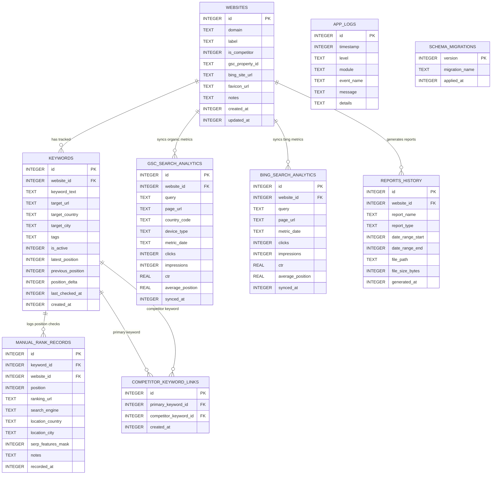

# RankScope Database Schema Specification 🗄️

This document defines the relational database architecture, table definitions, entity relationships, integrity constraints, and indexing strategies for RankScope.

---

## 1. Engine Configuration & Runtime Pragmas

RankScope uses an embedded **SQLite 3** database managed via the Flutter `sqflite` plugin.

On every database connection initialization, the following PRAGMAs are executed:

```sql
PRAGMA foreign_keys = ON;
PRAGMA journal_mode = WAL;
PRAGMA synchronous = NORMAL;
PRAGMA busy_timeout = 5000;
PRAGMA encoding = 'UTF-8';
```

- **Foreign Keys**: Enforces relational integrity across cascades.
- **WAL (Write-Ahead Logging)**: Delivers high concurrent read performance while write operations occur.
- **Synchronous Normal**: Optimal balance of performance and crash safety on modern flash storage.

---

## 2. Entity-Relationship Diagram (ERD)



---

## 3. Data Definition Language (DDL)

### 3.1. `websites`
Stores monitored properties, distinguishing between the user's primary websites and competitor entities.

```sql
CREATE TABLE IF NOT EXISTS websites (
    id INTEGER PRIMARY KEY AUTOINCREMENT,
    domain TEXT NOT NULL,
    label TEXT NOT NULL,
    is_competitor INTEGER NOT NULL DEFAULT 0 CHECK (is_competitor IN (0, 1)),
    gsc_property_id TEXT,
    bing_site_url TEXT,
    favicon_url TEXT,
    notes TEXT,
    created_at INTEGER NOT NULL,
    updated_at INTEGER NOT NULL
);

CREATE UNIQUE INDEX IF NOT EXISTS idx_websites_domain_competitor 
    ON websites (domain, is_competitor);
```

### 3.2. `keywords`
Maintains the search terms monitored for each website.

```sql
CREATE TABLE IF NOT EXISTS keywords (
    id INTEGER PRIMARY KEY AUTOINCREMENT,
    website_id INTEGER NOT NULL,
    keyword_text TEXT NOT NULL,
    target_url TEXT,
    target_country TEXT NOT NULL DEFAULT 'GLOBAL',
    target_city TEXT,
    tags TEXT,
    is_active INTEGER NOT NULL DEFAULT 1 CHECK (is_active IN (0, 1)),
    latest_position INTEGER,
    previous_position INTEGER,
    position_delta INTEGER DEFAULT 0,
    last_checked_at INTEGER,
    created_at INTEGER NOT NULL,
    FOREIGN KEY (website_id) REFERENCES websites (id) ON DELETE CASCADE
);

CREATE UNIQUE INDEX IF NOT EXISTS idx_keywords_unique_scope 
    ON keywords (website_id, keyword_text, target_country, target_city);

CREATE INDEX IF NOT EXISTS idx_keywords_website_active 
    ON keywords (website_id, is_active);

CREATE INDEX IF NOT EXISTS idx_keywords_latest_pos 
    ON keywords (latest_position);
```

### 3.3. `manual_rank_records`
Point-in-time discrete SERP rank audits performed by the user.

```sql
CREATE TABLE IF NOT EXISTS manual_rank_records (
    id INTEGER PRIMARY KEY AUTOINCREMENT,
    keyword_id INTEGER NOT NULL,
    website_id INTEGER NOT NULL,
    position INTEGER NOT NULL CHECK (position >= 1 AND position <= 100),
    ranking_url TEXT,
    search_engine TEXT NOT NULL DEFAULT 'Google' CHECK (search_engine IN ('Google', 'Bing', 'Yahoo', 'DuckDuckGo', 'Other')),
    location_country TEXT NOT NULL DEFAULT 'GLOBAL',
    location_city TEXT,
    serp_features_mask INTEGER NOT NULL DEFAULT 0,
    notes TEXT,
    recorded_at INTEGER NOT NULL,
    FOREIGN KEY (keyword_id) REFERENCES keywords (id) ON DELETE CASCADE,
    FOREIGN KEY (website_id) REFERENCES websites (id) ON DELETE CASCADE
);

CREATE INDEX IF NOT EXISTS idx_manual_records_keyword_date 
    ON manual_rank_records (keyword_id, recorded_at DESC);

CREATE INDEX IF NOT EXISTS idx_manual_records_website_date 
    ON manual_rank_records (website_id, recorded_at DESC);
```

#### SERP Features Bitmask Legend
`serp_features_mask` encodes SERP features using binary flags:
- `1` (Bit 0): Featured Snippet
- `2` (Bit 1): Local 3-Pack / Map
- `4` (Bit 2): People Also Ask (PAA)
- `8` (Bit 3): Video Carousel / YouTube Card
- `16` (Bit 4): Image Pack
- `32` (Bit 5): SiteLinks
- `64` (Bit 6): Knowledge Panel

### 3.4. `gsc_search_analytics`
Aggregated search metrics synced directly from the official Google Search Console API.

```sql
CREATE TABLE IF NOT EXISTS gsc_search_analytics (
    id INTEGER PRIMARY KEY AUTOINCREMENT,
    website_id INTEGER NOT NULL,
    query TEXT NOT NULL,
    page_url TEXT NOT NULL,
    country_code TEXT NOT NULL DEFAULT 'all',
    device_type TEXT NOT NULL DEFAULT 'all' CHECK (device_type IN ('all', 'DESKTOP', 'MOBILE', 'TABLET')),
    metric_date TEXT NOT NULL,
    clicks INTEGER NOT NULL DEFAULT 0,
    impressions INTEGER NOT NULL DEFAULT 0,
    ctr REAL NOT NULL DEFAULT 0.0,
    average_position REAL NOT NULL DEFAULT 0.0,
    synced_at INTEGER NOT NULL,
    FOREIGN KEY (website_id) REFERENCES websites (id) ON DELETE CASCADE
);

CREATE UNIQUE INDEX IF NOT EXISTS idx_gsc_unique_record 
    ON gsc_search_analytics (website_id, query, page_url, country_code, device_type, metric_date);

CREATE INDEX IF NOT EXISTS idx_gsc_query_date 
    ON gsc_search_analytics (website_id, query, metric_date);

CREATE INDEX IF NOT EXISTS idx_gsc_metric_date 
    ON gsc_search_analytics (website_id, metric_date);
```

### 3.5. `bing_search_analytics`
Aggregated search metrics synced directly from Bing Webmaster Tools API.

```sql
CREATE TABLE IF NOT EXISTS bing_search_analytics (
    id INTEGER PRIMARY KEY AUTOINCREMENT,
    website_id INTEGER NOT NULL,
    query TEXT NOT NULL,
    page_url TEXT,
    metric_date TEXT NOT NULL,
    clicks INTEGER NOT NULL DEFAULT 0,
    impressions INTEGER NOT NULL DEFAULT 0,
    ctr REAL NOT NULL DEFAULT 0.0,
    average_position REAL NOT NULL DEFAULT 0.0,
    synced_at INTEGER NOT NULL,
    FOREIGN KEY (website_id) REFERENCES websites (id) ON DELETE CASCADE
);

CREATE UNIQUE INDEX IF NOT EXISTS idx_bing_unique_record 
    ON bing_search_analytics (website_id, query, metric_date);

CREATE INDEX IF NOT EXISTS idx_bing_website_date 
    ON bing_search_analytics (website_id, metric_date);
```

### 3.6. `competitor_keyword_links`
Links a keyword monitored on a primary site to the identical keyword on a competitor site for automated side-by-side comparison.

```sql
CREATE TABLE IF NOT EXISTS competitor_keyword_links (
    id INTEGER PRIMARY KEY AUTOINCREMENT,
    primary_keyword_id INTEGER NOT NULL,
    competitor_keyword_id INTEGER NOT NULL,
    created_at INTEGER NOT NULL,
    FOREIGN KEY (primary_keyword_id) REFERENCES keywords (id) ON DELETE CASCADE,
    FOREIGN KEY (competitor_keyword_id) REFERENCES keywords (id) ON DELETE CASCADE,
    CONSTRAINT unique_keyword_pair UNIQUE (primary_keyword_id, competitor_keyword_id)
);
```

### 3.7. `reports_history`
Tracks generated local PDF/CSV export files on the device.

```sql
CREATE TABLE IF NOT EXISTS reports_history (
    id INTEGER PRIMARY KEY AUTOINCREMENT,
    website_id INTEGER NOT NULL,
    report_name TEXT NOT NULL,
    report_type TEXT NOT NULL CHECK (report_type IN ('PDF', 'CSV')),
    date_range_start INTEGER NOT NULL,
    date_range_end INTEGER NOT NULL,
    file_path TEXT NOT NULL,
    file_size_bytes INTEGER NOT NULL,
    generated_at INTEGER NOT NULL,
    FOREIGN KEY (website_id) REFERENCES websites (id) ON DELETE CASCADE
);

CREATE INDEX IF NOT EXISTS idx_reports_website 
    ON reports_history (website_id, generated_at DESC);
```

### 3.8. `schema_migrations`
Tracks incremental schema updates applied to the database.

```sql
CREATE TABLE IF NOT EXISTS schema_migrations (
    version INTEGER PRIMARY KEY,
    migration_name TEXT NOT NULL,
    applied_at INTEGER NOT NULL
);
```

### 3.9. `app_logs` (Schema v2)
Central diagnostic logging store capturing structured application lifecycle, database failures, backup/restore audits, and runtime exceptions.

```sql
CREATE TABLE IF NOT EXISTS app_logs (
    id INTEGER PRIMARY KEY AUTOINCREMENT,
    timestamp INTEGER NOT NULL,
    level TEXT NOT NULL,
    module TEXT NOT NULL,
    event_name TEXT NOT NULL,
    message TEXT NOT NULL,
    details TEXT
);

CREATE INDEX IF NOT EXISTS idx_logs_timestamp 
    ON app_logs (timestamp DESC);

CREATE INDEX IF NOT EXISTS idx_logs_level 
    ON app_logs (level);

CREATE INDEX IF NOT EXISTS idx_logs_module 
    ON app_logs (module);
```

#### Log Retention & Sanitization Policy
- **Cap:** Automatically bounded to a maximum of 2,000 entries. Oldest entries are trimmed periodically to keep database size constant.
- **Redaction:** Sensitive credentials (Google OAuth tokens, Bing API keys, passwords, client secrets) are scrubbed via `LogSanitizer` before disk persistence.

---

## 4. Migration Strategy

Migrations are executed sequentially inside an atomic transaction:

```dart
Future<void> onUpgrade(Database db, int oldVersion, int newVersion) async {
  for (int v = oldVersion + 1; v <= newVersion; v++) {
    final migration = migrationsRegistry[v];
    if (migration != null) {
      await db.transaction((txn) async {
        await migration.execute(txn);
        await txn.insert('schema_migrations', {
          'version': v,
          'migration_name': migration.name,
          'applied_at': DateTime.now().millisecondsSinceEpoch,
        });
      });
    }
  }
}
```
